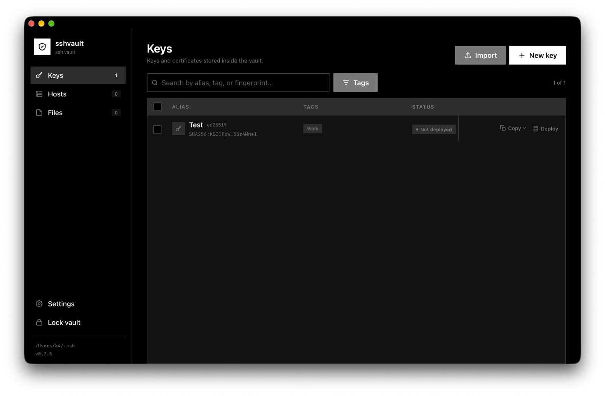
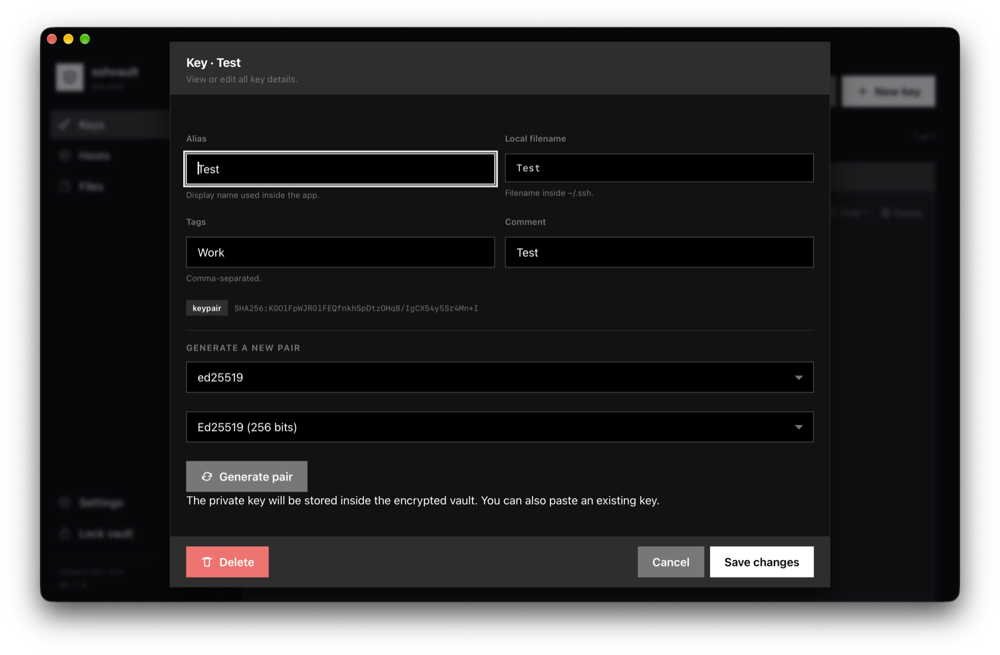
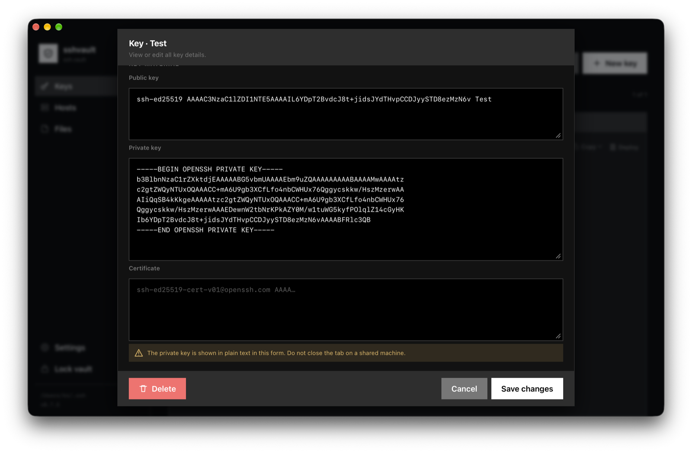
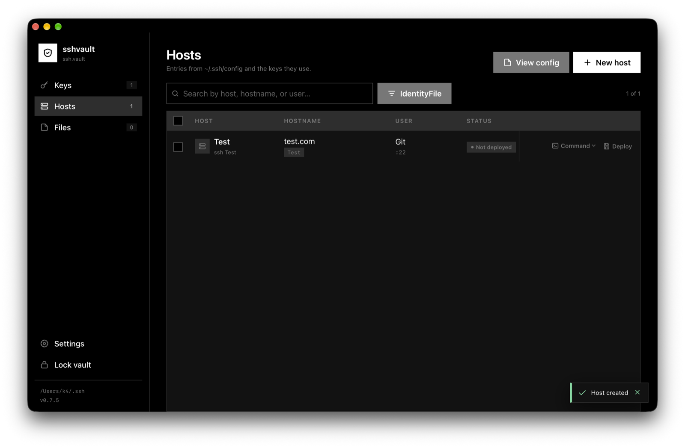
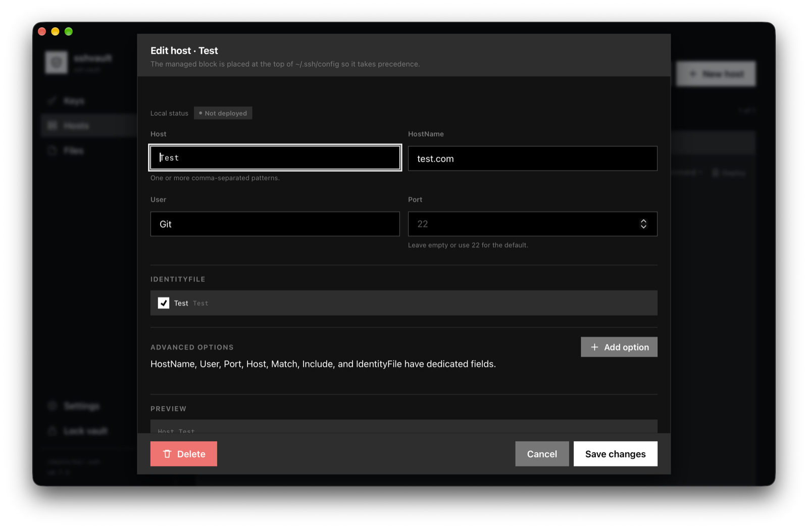
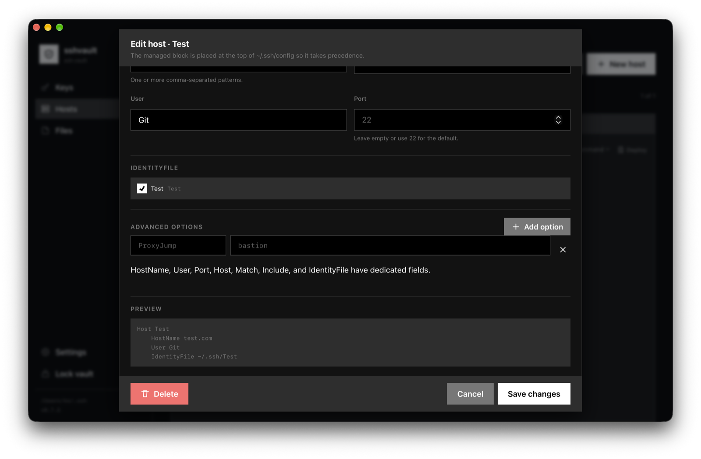
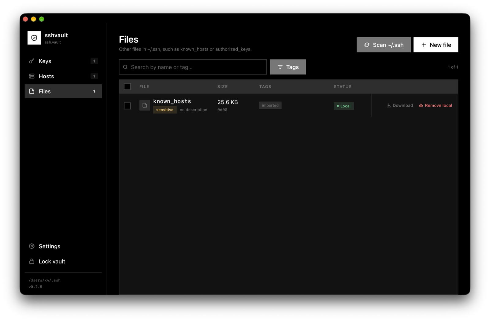
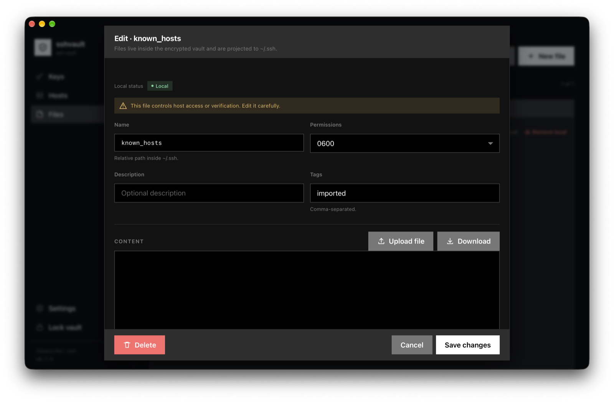
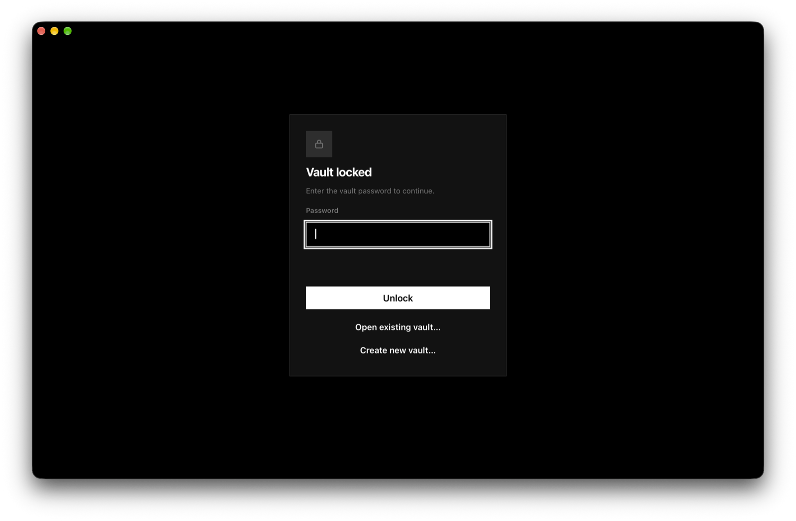

# sshvault

Local manager for SSH keys, certificates, hosts, and files from `~/.ssh`, with all state stored in a single encrypted, portable vault.

```text
$ sshvault
Ok! Serving http://localhost:7000
```

Open that URL in a browser. The app listens on loopback only and shows vault unlock or creation in its own interface.

[Website](https://lucasmenendez.github.io/sshvault/) · [Releases](https://github.com/lucasmenendez/sshvault/releases) · [License](LICENSE)

<p align="center">
  
</p>

## What it does

- **Keys**: public keys, private keys, and certificates with aliases, tags, fingerprints, and local deployment status. Copy, edit, generate ed25519/RSA/ECDSA key pairs, deploy them to `~/.ssh`, and remove local copies.
- **Hosts**: `~/.ssh/config` entries with `Host`, `HostName`, `User`, `Port`, multiple `IdentityFile` values, and ordered advanced options. Preview the managed block and copy the `ssh` command.
- **Files**: other files in `~/.ssh`, such as `known_hosts` or `authorized_keys`, with text or binary editing, download, deployment, and warnings for sensitive files.
- **Import**: scan `~/.ssh`, detect keys, certificates, hosts, and files, and add them to the vault without changing anything until you confirm. Private and public keys are paired by their base name before `.pub`, even when the public key has suffixes such as `.old` or `.crdownload`: `foo` + `foo.pub.old` becomes a `foo` key; an orphan `foo.pub.old` is imported as a public key named `foo`; and `foo.old` + `foo.pub.old` becomes a private key named `foo.old` plus a public key named `foo`.
- **Duplicate resolver**: detect `Host` entries defined both inside and outside the managed block. Comment out the old block, remove it with a backup, or keep only the non-duplicated patterns, one entry at a time.
- **Interface**: native HTML tables and vendored [Sumi.css](https://github.com/vladocar/Sumi.css) components, with **System / Light / Dark** themes in Settings.
- **Internal files**: names containing `.vault` (the vault itself, its `.lock`, backups, and similar files) are excluded from scanning and Files. If they were already imported, they are hidden and can be removed from the vault without touching the real file.
- **Idle lock**: 15 minutes by default. Locking discards the derived key from memory and the web app asks for the password again.
- **Password change**: re-encrypts the vault with a new salt.
- **Open another vault**: from the lock screen or Settings you can open an existing `ssh.vault` or create a new one at another path. Under `--ui`, the native file picker is available; in a browser, type the path.
- **Remember last vault**: optional Settings toggle. It stores only the path of the last successfully unlocked or created vault, never the password; disable it to return to the default vault on startup.
- **Web unlock**: the server starts locked and the UI asks for the password. If the vault does not exist, the UI offers to create it. `--change-password` remains a terminal-only operation.
- **macOS app**: a self-contained `SSHVault.app` with its own universal binary and icon, available from the Homebrew tap or built locally with `make app`.

## Screenshots

| Keys | Key details |
| --- | --- |
|  |  |
|  |  |
|  |  |
|  |  |



## Installation

Requires Go 1.27.1 or newer. Glaze is CGo-free, so no C compiler is required.

```bash
go build -o sshvault ./cmd/sshvault
# or
make build
```

You can also use `go install ./cmd/sshvault`.

### Homebrew (macOS)

```bash
brew tap lucasmenendez/sshvault
# Homebrew 7 or newer: trust the third-party tap
brew trust lucasmenendez/sshvault
brew install sshvault
sshvault --ui
```

The tap contains the formula published automatically from the project's releases.

### macOS app

The tap also provides a self-contained app with its own binary and icon:

```bash
brew install --cask lucasmenendez/sshvault/sshvault-app
```

It installs `SSHVault.app` in `/Applications`. The app does not depend on the
Homebrew CLI installation.

To build the app locally instead:

```bash
make app
open build/SSHVault.app
```

To copy the local build to `~/Applications`:

```bash
make install-app
```

The local build and the cask build are ad-hoc signed and **not notarized by
Apple**. If macOS blocks the first launch, use **System Settings → Privacy &
Security → Open Anyway**, or Control-click the app in Finder and choose
**Open**. This is documented rather than bypassing Gatekeeper automatically.

Only macOS and Linux are supported. The binary uses `flock`, POSIX permissions, and symlinks. The native `--ui` window uses the system WebView: WKWebView on macOS and WebKitGTK on Linux. On Linux, WebKitGTK must be installed (`libwebkit2gtk-4.1-0` on Debian/Ubuntu, for example).

## Usage

```bash
# Default vault: ~/.ssh/ssh.vault
./sshvault

# Explicit path
./sshvault -f ./work.vault
./sshvault ./work.vault

# Alternative SSH directory (useful for testing)
# The default vault becomes /tmp/ssh-test/ssh.vault
./sshvault --ssh-dir /tmp/ssh-test

# If ./ssh.vault exists but ~/.ssh/ssh.vault does not, it is not opened automatically:
./sshvault -f ./ssh.vault

# Another port, and open the browser
./sshvault --addr 127.0.0.1:8080 --open

# Native UI (Glaze), without an external browser
./sshvault --ui

# Change the password and exit
./sshvault --change-password
```

Without `-f` or a positional argument, the CLI uses `~/.ssh/ssh.vault`; with `--ssh-dir /path`, it uses `/path/ssh.vault`. There is no automatic fallback to `./ssh.vault`: if it exists, a hint is shown and you can open it from the web UI with **Open existing vault…** or with `-f ./ssh.vault`.

The CLI no longer prompts for the password in the terminal during normal startup. It starts the server locked and the web app asks for the password; if the file does not exist, it offers to create it. `--change-password` remains an explicit terminal operation.

### Flags

| Flag | Description |
| --- | --- |
| `-f`, `--file` | Vault path. Defaults to `~/.ssh/ssh.vault`, or `<ssh-dir>/ssh.vault` when `--ssh-dir` is used. |
| `--ssh-dir` | SSH directory to manage. Defaults to `~/.ssh`. |
| `--addr` | Listen address. Loopback only: `127.0.0.1`, `::1`, or `localhost`. |
| `--lock-after` | Idle duration before locking. `0` disables it. |
| `--open` | Open the URL in the default browser. Incompatible with `--ui`. |
| `--ui` | Open the UI in a native Glaze window. Incompatible with `--open` and `--change-password`. |
| `--change-password` | Change the password in the terminal and exit. |
| `--version` | Print the version. |

## Security

- **Encryption**: Argon2id (64 MiB, 3 passes, 4 threads) + XChaCha20-Poly1305. The header is authenticated as AAD.
- **Versioned format**: magic, version, KDF parameters, salt, nonce, and ciphertext. KDF parameters are validated before use to prevent excessive resource consumption.
- **Atomic writes** and rotating encrypted vault backups.
- **Permissions**: vault `0600`, private keys `0600`, public keys/certificates `0644`, and `~/.ssh` `0700` when created.
- **Loopback only**: the web server is not exposed to the network. `Host`, `Origin`, `Sec-Fetch-Site`, and `Content-Type` are validated to mitigate CSRF and DNS rebinding.
- **Strict CSP**, with no CDNs or external resources.
- **No token**: any local user could access the app while the vault is unlocked. Use idle locking and do not leave it running on shared servers.
- **No recovery**: if you lose the password, there is no way to open the vault. Backups use the same password.
- **Secrets in memory**: Go cannot reliably erase strings. Locking or exiting discards the derived key and decrypted document, but the process may have materialized private-key strings. Do not run the app on an untrusted machine.
- **Clipboard**: copying a private key makes it available to other processes. The app asks for confirmation and warns about this.

## Deployment model

The vault is the source of truth for the entries it manages; `~/.ssh` is the destination.

- Each key stores a stable `filename`. New keys use `id_<alias>`; imported keys keep their original name.
- Paths: `~/.ssh/<filename>`, `<filename>.pub`, and `<filename>-cert.pub`.
- Hosts live in a **managed block** at the top of `~/.ssh/config`, delimited by markers. The rest of the file is left untouched.
- The block is placed first because OpenSSH uses the first matching value it finds; specific entries therefore take priority over trailing `Host *` entries.
- Editing a deployed entry synchronizes the local file. If the local file changed outside the app, it is marked as **drift** and is not overwritten without confirmation.
- Unmanaged files are detected and can be imported, but are never deleted automatically.
- Deleting an entry from the vault asks whether to delete its local copy too.

## Rows and actions

- Tables use native HTML (`table`, `thead`, `tbody`, `tr`, `th`, `td`) with the action column fixed to the right; the header and cells share the same border.
- Clicking a **Keys**, **Hosts**, or **Files** row opens the unified modal for viewing, editing, and deleting.
- The checkbox still selects rows for bulk actions.
- `Enter` or `Space` on a focused row also opens the modal.
- Row actions:
  - **Keys**: `Copy` menu + `Deploy` / `Remove local`.
  - **Hosts**: `Command` menu + `Deploy` / `Remove local`.
  - **Files**: `Download` + `Deploy` / `Remove local`.
- In a conflict/drift state: `Resolve`.
- Edit and delete live inside the modal, not in the row.

### Duplicate resolver

If a host exists in the managed block and also outside it, the app shows a warning. The resolver:

- Shows the blocks one at a time.
- By default **comments out** the old block with `# `, which is reversible.
- Allows **removing** it after a second confirmation and a backup.
- If the outside block has several patterns and only some are duplicated, allows **keeping the non-duplicated patterns** by rewriting the `Host` line.
- Does not touch the managed block.
- Checks a config hash before writing; if the file changed, it aborts and reloads.

Only deployed hosts are considered. Imported but undeployed hosts do not generate duplicates yet.

### Internal files

- Names containing `.vault` are excluded from scanning and Files, along with the actual vault, its `.lock`, and its `.bak.*` files.
- If the vault already contains Files entries with those names, they are hidden and a warning offers to remove them from the vault.
- That cleanup **does not delete the real file** from disk.

## Interface

- Visual base: [Sumi.css](https://github.com/vladocar/Sumi.css) v1.0.0, vendored in `internal/web/static/sumi.css` (MIT, no CDN).
- `--s-*` tokens: the dark theme uses `--s-bg:#000`, `--s-surface:#2e2e2e`, `--s-card:#121212`, and `--s-radius:0`; the light theme inverts the scale while preserving contrast.
- **System / Light / Dark** selector in Settings. It is stored in `localStorage`; **System** follows `prefers-color-scheme`.
- `<dialog><article>` modals, buttons, and forms based on Sumi. Tables and the action column do not duplicate borders or shadows.
- The **Copy** and **Command** menus are Sumi dropdowns (`<details class="dropdown">`); the panel is mounted on `body` when opened so it stays above the table.

## Changes 0.7.6

- The sidebar now shows the path of the active vault above the version instead of always showing the SSH directory.
- Added a GitHub Pages landing page with features, screenshots, installation instructions, and the security and licensing model.
- Added optimized screenshot copies for the README and website while keeping the original captures.
- Updated the favicon and app icon from the same header shield mark.
- The Pages workflow publishes `site/` and the optimized screenshots automatically on pushes to `main`.

## Changes 0.7.5

- Added a self-contained `SSHVault.app` with its own universal binary, icon, and app metadata.
- The app opens directly in the Glaze interface when launched from Finder (`SSHVAULT_APP_MODE=1`).
- Added the `sshvault-app` Homebrew Cask for installing the app in `/Applications`.
- Added `make app` and `make install-app` for local app builds.
- The app icon is generated once from the header shield mark and committed as `AppIcon.icns`; it is not regenerated on install.
- Updated the web favicon to match the app icon.
- App builds are ad-hoc signed; Apple notarization is not available without a Developer ID.
- The release workflow now builds and publishes `SSHVault-<version>.zip` and updates both the formula and the cask.

## Changes 0.7.4

- New **Create new vault…** flow in Settings and on the lock screen, allowing a vault to be created at another path without touching the default vault.
- Empty files can be explicitly initialized from **Create new vault**. Opening an empty file with **Open existing** shows a specific error and does not modify it.
- Creating a vault at a new path creates the parent directory if needed, with `0700` permissions (for example, `~/vaults/ssh.vault`).
- A file with content is never overwritten when creating another vault.
- New **Remember last vault** option in Settings, disabled by default. It stores the path only after a successful unlock or creation, never the password.
- The remembered path is stored in the user's configuration directory (`~/Library/Application Support/sshvault/config.json` on macOS) with `0600` permissions.
- The remembered path is ignored when `-f` or a positional path is provided, and when `--ssh-dir` is used.
- Vault paths are normalized so opening the same file through a symlink no longer fails with "vault in use".
- Settings shows **Open default vault** when the active vault is not `<ssh-dir>/ssh.vault`.
- Key/value rows in the Vault panel are vertically centered.
- The README is now in English.

## Changes 0.7.3

- In the responsive layout, all menu options are left-aligned and consecutive.
- Removed the automatic `space-between` distribution between Keys/Hosts/Files and Settings/Lock.
- With labels or in icon-only mode, items keep the same order and uniform spacing.
- The menu does not wrap: if it does not fit, the top bar scrolls horizontally.
- At 360 px wide, all options fit without clipping.

## Changes 0.7.2

- The main header and toolbar of each view stay fixed.
- Table headers (`thead`) are sticky inside the list area.
- Only the row area scrolls; the sidebar and logo stay fixed.
- Settings uses its own scroll area while keeping the header visible.
- The `body` no longer scrolls, avoiding double scrollbars and sidebar movement.
- The responsive layout is preserved: on narrow windows the sidebar moves to the top and the content remains the scroll area.

## Changes 0.7.1

- In the native window, only the main content scrolls; the sidebar and logo stay fixed under the titlebar and do not move toward the window controls.
- The action column is wider and row buttons use tighter spacing. `Command`, `Download`, `Copy`, and `Remove local` fit in their column without invading the status column.

## Changes 0.7.0

- Normal startup no longer prompts for the password in the terminal: the server starts locked and the web app shows the unlock modal. This applies to `sshvault`, `--open`, and `--ui`.
- If the vault does not exist, the web app offers to create it with a password and confirmation.
- The lock screen and Settings include **Open existing vault…** to open an `ssh.vault` from any folder and **Create new vault…** to create one at another path.
- Under `--ui`, the file picker uses Glaze's native dialog; in a browser, the path can be typed.
- The active vault can be changed without restarting; the previous vault is closed and its lock is released.
- `--change-password` remains a terminal operation.

## Changes 0.6.0

- New `--ui` flag: starts the existing server and opens a native Glaze window.
- `--ui` keeps the server, port, session, and graceful shutdown behavior; closing the window shuts down the server.
- On macOS the window uses a transparent titlebar, full-size content, and system traffic lights over the app background.
- Glaze is CGo-free; the project now requires Go 1.27.1.
- `--open` still opens the browser and is incompatible with `--ui`.
- On Linux, `--ui` requires WebKitGTK at runtime.

## Changes 0.5.0

- The entire web UI is in English.
- The CLI default vault is `~/.ssh/ssh.vault`; with `--ssh-dir` it is `<ssh-dir>/ssh.vault`.
- `-f`/`--file` and the positional argument still take priority. If `./ssh.vault` exists but the default vault does not, it is not opened automatically: a hint is shown.
- The first run with the default vault creates `~/.ssh` with `0700` permissions when needed.

## Changes 0.4.1

- The search field and filter button share height and baseline in Keys, Hosts, and Files.
- The **Copy** and **Command** row menus use Sumi's `<details class="dropdown">` disclosure; the panel is mounted on `body` so it is not clipped by the table.
- Fixed opening the host editor for hosts with advanced options.

## Changes 0.4.0

- Import: pairing by base name before `.pub`, including suffixes such as `.old` and `.crdownload`; orphan public keys are imported as keys.
- Native HTML tables and a border fix in the action column.
- Visual migration to Sumi.css with the project's dark tokens, inverted light theme, and System/Light/Dark selector.

## Backups

- The vault keeps up to 5 encrypted copies: `<vault>.bak.<timestamp>`.
- Before rewriting `~/.ssh/config` or a managed file, a copy is saved in `~/.ssh/.sshvault-backups/` (up to 20).
- Private keys are not copied in cleartext to local backups; their previous version remains in the encrypted vault backups.

## License

sshvault is distributed under the **GNU Affero General Public License v3.0 only** (`AGPL-3.0-only`). The full text is in [LICENSE](LICENSE). The source code for each release is available at the corresponding repository tag.

Sumi.css remains under its original MIT license; its notice is in the header of `internal/web/static/sumi.css`.

## Development

```bash
make test
make vet
make build
```

The UI is a build-free SPA: HTML, CSS, and JavaScript embedded with `go:embed`. Node is not required to build or run it. The Sumi.css base is vendored; keep its MIT license header when updating it.

## Known limitations

- Certificates are not signed by the app; they are stored, imported, and deployed.
- `Include` and `Match` in existing configs are preserved outside the managed block, but are not managed from the UI.
- Directories inside `~/.ssh` are not managed.
- Windows is not supported.
- Limit: 4 MiB per file and 32 MiB per vault.
- If the vault is on a filesystem without reliable `flock`, cross-process locking may not work.
